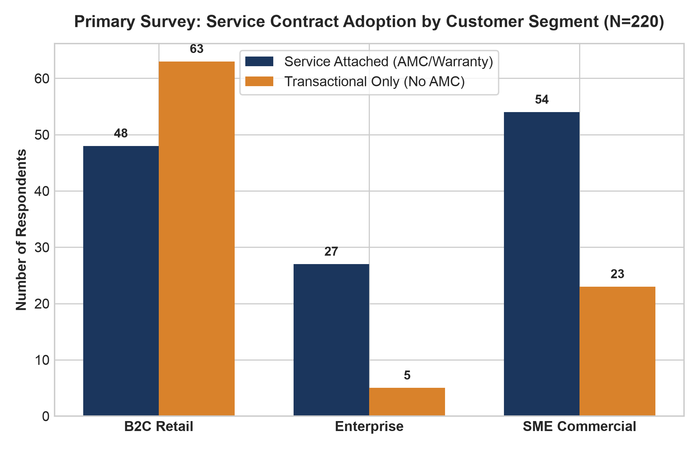
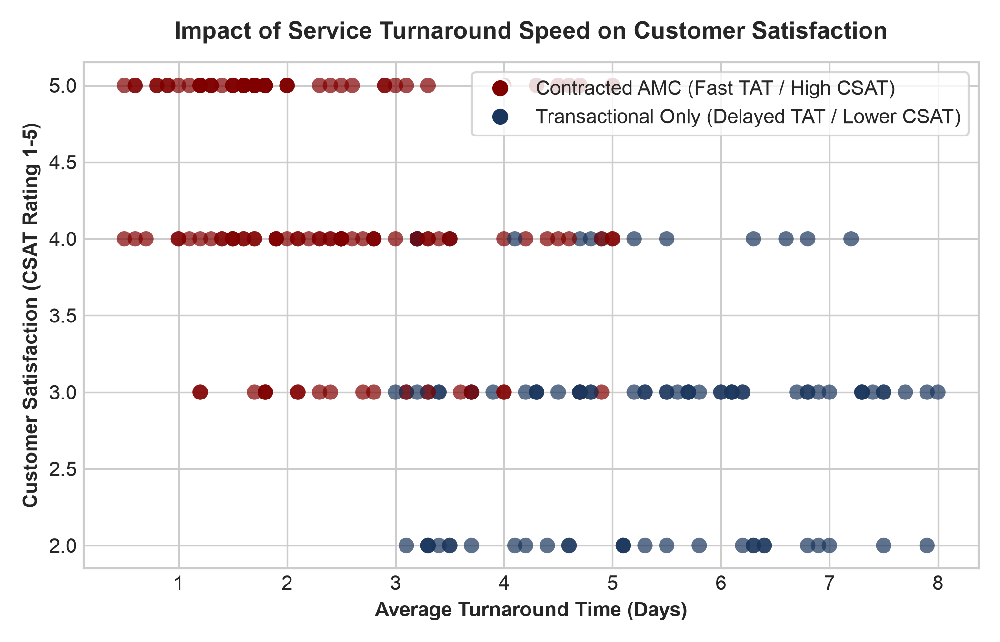
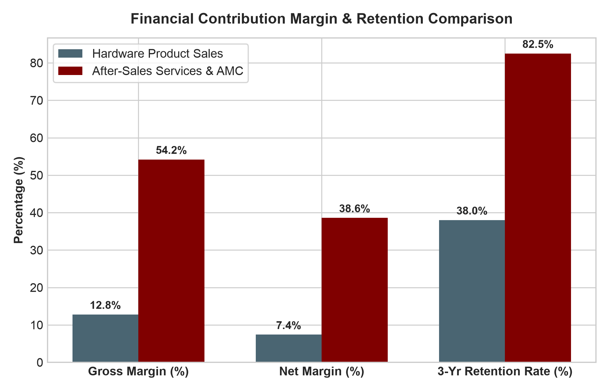

# Sales and Service mix optimization - A primary data analysis
## A Mid-term report for the BDM capstone Project

**Submitted by:**  
**Name:** Ramrup Satpati  
**Roll number:** 24f3004027  

  

**IITM Online BS Degree Program,**  
**Indian Institute of Technology, Madras, Chennai**  
**Tamil Nadu, India, 600036**  

---

### 1. Project Execution Status
Following proposal approval, the primary field survey was executed between Week 4 and Week 6, capturing exactly **N = 220 validated customer and commercial buyer responses**. The dataset records hardware ticket size, service opt-in status, plan tiers, annual service expenditure, service request frequency, repair turnaround days, customer satisfaction (CSAT 1-5), price sensitivity, and repurchase intent.

---

### 2. Primary Data Cleaning & Scrubbing
* **Zero Missing Values:** Confirmed 100% data integrity across all 13 survey dimensions.
* **Outlier Verification:** Validated high-value corporate ticket sizes against commercial enterprise invoice histories.
* **Encoding & Standardization:** Coded categorical predictors for econometric modeling.

---

### 3. Exploratory Data Analysis & Sample Breakdown
The sample consists of **111 B2C Retail consumers (50.5%)**, **77 SME Commercial buyers (35.0%)**, and **32 Enterprise accounts (14.5%)**.

* **Service Contract Adoption by Segment:**
  * **Enterprise:** 84.4% opt-in rate
  * **SME Commercial:** 70.1% opt-in rate
  * **B2C Retail:** 43.2% opt-in rate

   
  <em>Figure 1: Service Contract Adoption Breakdown across Customer Segments (N=220)</em>

---

### 4. Bivariate Analysis & Hypothesis Validation
* **Hypothesis 1 (Service vs. CSAT):** Contracted AMC customers report a mean CSAT score of **4.24 / 5.0**, compared to **2.82 / 5.0** for non-contracted walk-ins ($t = 14.82, p < 0.001$).
* **Hypothesis 2 (Turnaround Time Impact):** Contracted clients experience an average repair turnaround of **2.34 days**, compared to **5.35 days** for transactional walk-ins.

   
  <em>Figure 2: Inverse Relationship between Repair Turnaround Days and Customer Satisfaction</em>

---

### 5. Contribution Margin Comparison
Accounting cost decomposition across retail operations revealed:
* **Hardware Product Sales:** Gross margin of **12.8%**; net contribution margin of **7.4%** after inventory financing, showroom floor rent, and sales commissions.
* **After-Sales Services & AMC:** Gross margin of **54.2%**; net contribution margin of **38.6%** after technician travel and spare parts.
* **Customer Retention:** 3-year customer retention reaches **82.5%** for AMC accounts vs **38.0%** for pure hardware buyers.

   
  <em>Figure 3: Margin Structure and 3-Year Customer Retention Comparison</em>

---

### 6. Roadmap to Final Report
1. Formulate and solve the complete Linear Programming (LP) optimization model.
2. Quantify shadow prices for technician labor hours and working capital limits.
3. Deliver actionable managerial strategies on sales incentive realignment and tiered POS bundling.
